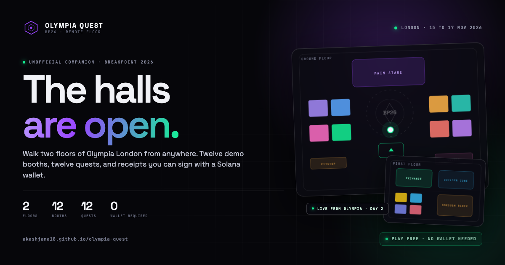
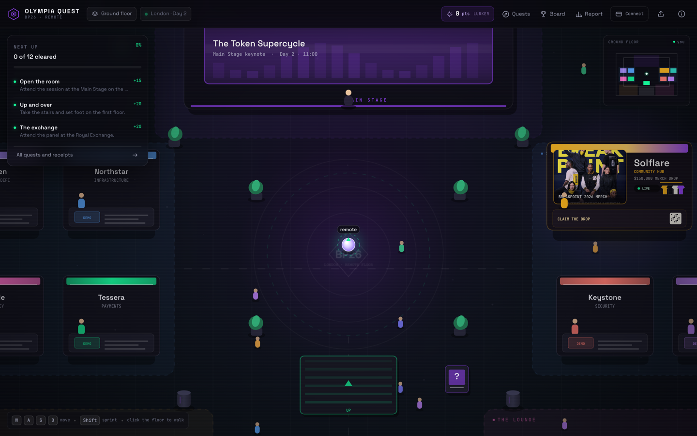
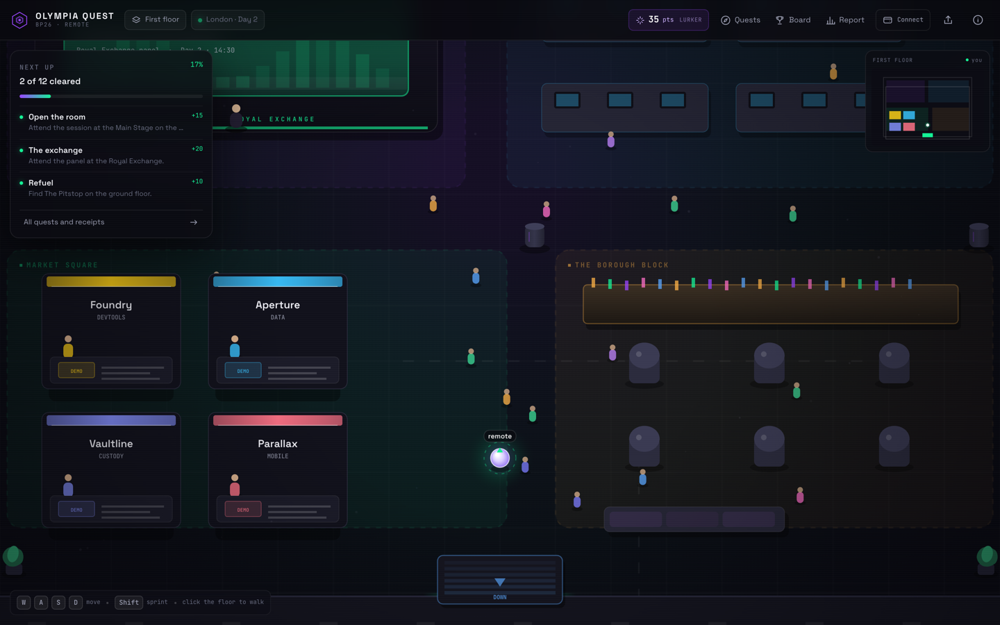
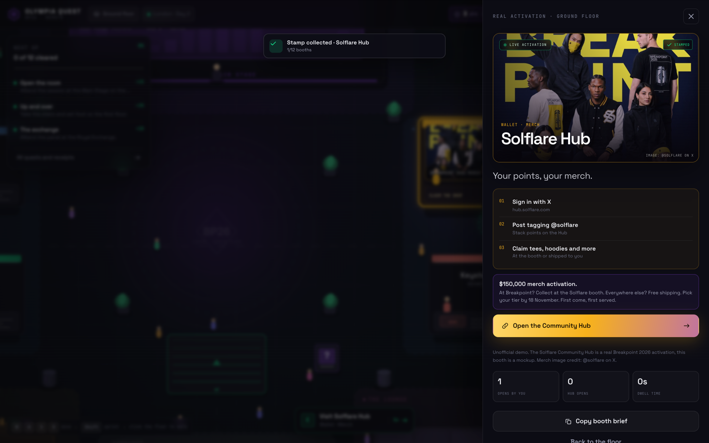

# Olympia Quest

**A playable remote floor for Solana Breakpoint 2026.**

[Play it in the browser](https://breakpoint26.solanaconsensuslab.com/) (desktop or phone, no wallet needed). The GitHub Pages mirror is at [akashjana18.github.io/olympia-quest](https://akashjana18.github.io/olympia-quest/).



Olympia Quest is an unofficial companion for Breakpoint 2026 in London. If you could not make it to Olympia, this lets you walk a stylised version of the venue, collect stamps at demo sponsor booths, clear quests, sign receipts with a Solana wallet, and see the sponsor report that would make the whole thing pay for itself.

> Unofficial fan project. Not affiliated with Solana Foundation or Olympia London. Sponsor booths are fictional demos. The venue layout is inspired by the public Breakpoint 2026 map, not a survey.

## What is in the build

- Two explorable floors: Main Stage and sponsor rows downstairs, Royal Exchange, Builder Zone, Market Square and The Borough Block upstairs.
- Twelve quests, twelve booths, and a 421 point clear.
- A real Solflare Community Hub activation: the official merch image from @solflare on X, the $150,000 drop steps, and a direct link to hub.solflare.com.
- A walkable canvas world with collisions, ambient crowd, floor switching, minimap and proximity prompts.
- Wallet optional. Connect Phantom, Solflare or Backpack to sign a receipt with `signMessage`. Nothing is spent, sent or gated.
- A local leaderboard seeded with demo players.
- A sponsor report with a funnel, per-booth engagement, session metrics and CSV export.
- Responsive controls: WASD and click-to-move on desktop, virtual joystick and action button on touch.
- No backend, no analytics, no account. Progress lives in `localStorage`.

## Screens

Ground floor, with the Main Stage and the sponsor rows:



First floor, with Market Square and The Borough Block:



The real Solflare Community Hub activation, with the official merch image from X:



## Play

Desktop:

| Input | Action |
| --- | --- |
| `W` `A` `S` `D` or arrows | Move |
| `Shift` | Sprint |
| `E` or `Space` | Interact with the nearest booth, stage, stairs or terminal |
| Click the floor | Walk to that point |

Mobile:

- Left joystick to move.
- Right action button to interact.
- Tap the floor to walk.
- Menu button for quests, leaderboard, sponsor report and about.

## Why this exists

Remote attendees get a livestream and a chat box. They do not get the floor, the booths, or anything a sponsor can measure. Olympia Quest is a small proof that a remote floor can produce the three things an event actually sells:

1. **Attention**: a reason to stay with the conference after the keynote ends.
2. **Qualified engagement**: booth opens, demo actions, dwell time and wallet-signed receipts.
3. **A renewal argument**: a sponsor dashboard with numbers, not vibes.

The sponsor report is the product. The game is how you get people into it.

### Sponsor model in one screen

- **Virtual booth package**: branded booth, one sponsored quest, leaderboard placement, and an engagement report. Sell it to projects that could not justify a physical booth or missed the floor plan.
- **Organizer license**: white-label the engine for the next conference, priced per event or per remote attendee, with a cut of sponsor packages.
- **Lead capture**: a demo action is a qualified lead, the same budget line as a badge scan at a physical booth.
- **Collectibles**: compressed NFT stamps and proof of presence as an upsell, not the business.

The demo numbers in the report are labelled as sample data. Your session numbers are real and stay in your browser.

## How it is built

- React 19 and TypeScript.
- A hand-drawn Canvas 2D renderer: floor textures, booths, stage screens, crowds, camera, particles and a responsive zoom.
- A small game engine with circle-vs-rect collision, keyboard and pointer input, floor switching and proximity interactions.
- Solana wallet message signing through injected providers, with no web3 dependency.
- `localStorage` persistence for progress, receipts, booth stats and settings.
- Vite, deployed to GitHub Pages.

```
src/
  game/
    types.ts      venue data types
    world.ts      the two floors, booths, zones and interactables
    quests.ts     quest catalog, tiers and trivia
    engine.ts     loop, input, collision, camera, crowd
    render.ts     canvas art, depth sorting, stage screens
  state/
    player.ts     progress, stamps, receipts, persistence
    wallet.ts     provider detection, base58, signMessage
    report.ts     sponsor metrics and CSV
    leaderboard.ts
  ui/             responsive shell, HUD, sheets and panels
```

## Run locally

```bash
npm install
npm run dev
```

The dev server serves the app at `/`. The GitHub Pages workflow sets `VITE_BASE=/olympia-quest/` for the mirror build; Vercel uses the default root base.

```bash
npm run build
npm run preview
```

## Deploy

### Vercel (primary)

The primary deployment is `breakpoint26.solanaconsensuslab.com`, built by Vercel from this repo with `vercel.json`.

```bash
npx vercel --prod
npx vercel domains add breakpoint26.solanaconsensuslab.com
```

### GitHub Pages (mirror)

The repository also ships with a GitHub Pages workflow in `.github/workflows/deploy.yml`. Push to `main`, then set the Pages source to **GitHub Actions** in repository settings if it is not already enabled.

If you rename the repository, update `base` in `vite.config.ts` and the absolute `og:url` and `og:image` URLs in `index.html`.

## Swap in real sponsors

Every booth is a plain object in `src/game/world.ts`:

```ts
booth("lumen", "Lumen", "Private DeFi", "Shielded swaps.", "Private route demo", "#A78BFA", 170, 500)
```

Change the name, category, offer, colour and position. Quests are in `src/game/quests.ts`. The seeded report values are in `src/state/report.ts` and are clearly labelled as sample data.

## Privacy

No analytics, no server calls, no wallet gate. A wallet signature is produced locally and stored next to the receipt in `localStorage`. Clearing site data clears the run.

## License

MIT. See [LICENSE](LICENSE).
